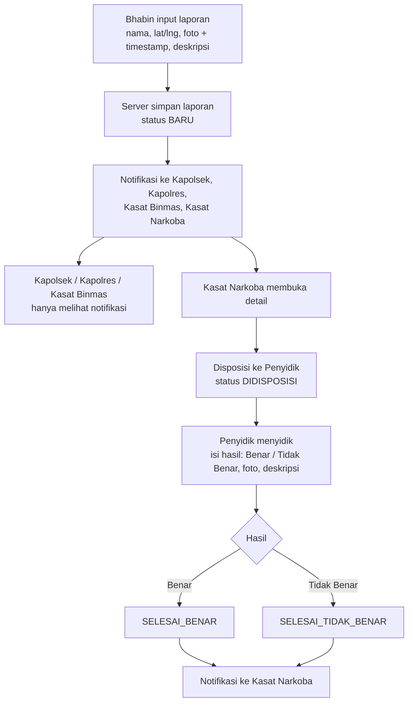
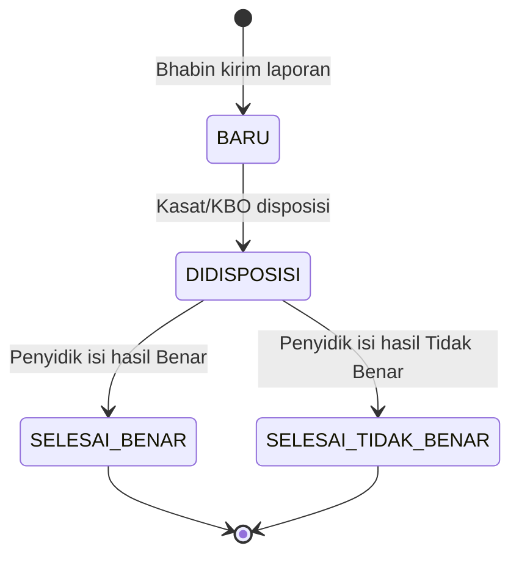

# ALUR APLIKASI: Pelaporan Informasi Terindikasi Narkoba

Dokumen acuan alur bisnis, status, dan hak akses. Dipakai bersama `prompt-frontend-angular-ionic.md` dan `prompt-backend-express.md`. Jika ada konflik, dokumen ini yang menjadi rujukan alur.

## 1. Aktor

| Aktor | Kode | Ringkasan peran |
|---|---|---|
| Bhabin | `BHABIN` | Membuat laporan di lapangan |
| Kapolsek | `KAPOLSEK` | Menerima notifikasi saja |
| Kapolres | `KAPOLRES` | Menerima notifikasi saja |
| Kasat Binmas | `KASAT_BINMAS` | Menerima notifikasi saja |
| Kasat Narkoba | `KASAT_NARKOBA` | Satu-satunya yang melihat detail (selain pihak yang ditunjuk), disposisi, delegasi |
| Penyidik Narkoba / Kanit Lidik | `PENYIDIK` | Menyidik dan melaporkan hasil |
| KBO | `KBO` | Pengganti Kasat saat berhalangan, lewat delegasi berjangka |
| Admin | `ADMIN` | Kelola pengguna, satuan, audit log |

## 2. Alur utama

### Langkah rinci

**A. Bhabin membuat laporan**
1. Login, buka "Buat Laporan".
2. Isi nama, lokasi (GPS otomatis, bisa dikoreksi), foto dengan timestamp, deskripsi.
3. Kirim. Jika offline, laporan disimpan sebagai draft terenkripsi dan dikirim otomatis saat online.
4. Server membuat nomor laporan, status `BARU`, dan notifikasi untuk empat penerima.

**B. Notifikasi**
- Empat penerima mendapat push dan notifikasi dalam aplikasi.
- Isi notifikasi hanya: nomor laporan, wilayah, waktu. Tanpa nama, foto, deskripsi, koordinat, atau identitas pelapor.
- Kapolsek, Kapolres, dan Kasat Binmas tidak bisa membuka detail.

**C. Disposisi dan penyidikan**
1. Kasat Narkoba membuka detail, memilih Penyidik, menulis catatan disposisi. Status menjadi `DIDISPOSISI`, Penyidik dinotifikasi.
2. Penyidik membuka laporan yang didisposisikan kepadanya.
3. Penyidik mengisi hasil: **status (Benar / Tidak Benar)**, foto, deskripsi. Hanya sekali per disposisi.
4. Status laporan menjadi `SELESAI_BENAR` atau `SELESAI_TIDAK_BENAR`. Kasat Narkoba dinotifikasi.

**D. Delegasi ke KBO (khusus Kasat Narkoba)**
1. Kasat membuka "Delegasi Akses", mengisi **NRP KBO**, **tanggal mulai s.d. selesai**, dan cakupan (semua laporan atau laporan tertentu).
2. Sistem memvalidasi NRP: pengguna aktif, berperan KBO, satuan sama. Tampilkan nama dan pangkat untuk konfirmasi.
3. Selama periode aktif, KBO dapat melihat detail dan melakukan disposisi. Di luar periode, akses otomatis tertutup.
4. Kasat dapat **mencabut** delegasi kapan saja.

## 3. Status laporan

| Status | Label di UI | Warna |
|---|---|---|
| `BARU` | Baru | Kuning |
| `DIDISPOSISI` | Didisposisi | Biru-abu |
| `SELESAI_BENAR` | Selesai – Benar | Hijau |
| `SELESAI_TIDAK_BENAR` | Selesai – Tidak Benar | Merah |

Aturan transisi: hanya maju searah di atas. Disposisi ulang (ganti penyidik) boleh selama belum selesai, dan tercatat di riwayat.

## 4. Status delegasi

| Kondisi | Keterangan |
|---|---|
| Akan datang | Hari ini sebelum `tgl_mulai`, KBO belum punya akses |
| Aktif | Hari ini antara `tgl_mulai` dan `tgl_selesai`, belum dicabut |
| Selesai | Lewat `tgl_selesai` |
| Dicabut | `is_revoked = true`, akses langsung tertutup |

Hitungan hari memakai zona waktu `Asia/Jakarta`. Tidak boleh ada dua delegasi aktif yang tumpang tindih untuk KBO yang sama.

## 5. Matriks hak akses

| Tindakan | Bhabin | Kapolsek / Kapolres / Kasat Binmas | Kasat Narkoba | Penyidik | KBO | Admin |
|---|---|---|---|---|---|---|
| Buat laporan | Ya | – | – | – | – | – |
| Lihat laporan sendiri | Ya | – | – | – | – | – |
| Terima notifikasi laporan baru | – | Ya | Ya | – | – | – |
| Lihat detail laporan | Hanya miliknya | **Tidak** | Ya | Hanya yang didisposisikan | Hanya saat delegasi aktif | Tidak |
| Disposisi | – | – | Ya | – | Saat delegasi aktif | – |
| Isi hasil penyidikan | – | – | – | Ya (penerima disposisi) | – | – |
| Buat / cabut delegasi | – | – | Ya | – | – | – |
| Kelola pengguna dan satuan | – | – | – | – | – | Ya |
| Lihat audit log | – | – | – | – | – | Ya |

Penegakan hak akses dilakukan **di backend**. UI hanya menyembunyikan menu agar tidak membingungkan.

## 6. Matriks notifikasi

| Kejadian | Penerima | Isi ringkas (tanpa data sensitif) |
|---|---|---|
| Laporan baru | Kapolsek, Kapolres, Kasat Binmas, Kasat Narkoba | "Laporan baru {no_laporan} – {wilayah} – {waktu}" |
| Disposisi | Penyidik tujuan | "Disposisi baru {no_laporan}" |
| Hasil penyidikan | Kasat Narkoba (dan KBO bila delegasi aktif) | "Hasil penyidikan {no_laporan} telah masuk" |
| Delegasi dibuat | KBO tujuan | "Anda menerima delegasi akses {tgl_mulai} s.d. {tgl_selesai}" |
| Delegasi dicabut | KBO tujuan | "Delegasi akses dicabut" |

## 7. Jejak audit

Dicatat otomatis: login (berhasil dan gagal), buat laporan, **setiap pembukaan detail laporan dan foto**, disposisi, hasil penyidikan, pembuatan dan pencabutan delegasi, perubahan pengguna. Setiap catatan menyimpan pengguna, waktu, IP, dan user agent. Audit log tidak dapat diubah atau dihapus lewat API.

## 8. Peta layar per peran

| Peran | Layar |
|---|---|
| Bhabin | Login → Beranda → Buat Laporan → Laporan Saya → Detail (milik sendiri) |
| Kapolsek / Kapolres / Kasat Binmas | Login → Beranda → Notifikasi (tanpa tautan detail) |
| Kasat Narkoba | Login → Beranda → Daftar Laporan → Detail → Form Disposisi; Delegasi Akses (daftar + form) |
| Penyidik | Login → Beranda → Disposisi Masuk → Detail → Form Hasil Penyidikan |
| KBO | Login → Beranda → Daftar Laporan (saat delegasi aktif) → Detail → Form Disposisi; Delegasi Diterima |
| Admin | Login → Pengguna, Satuan, Audit Log |

## 9. Kasus tepi yang harus ditangani

- Laporan dikirim saat offline: draft terenkripsi, kirim ulang otomatis, cegah duplikat dengan kunci idempotensi.
- Delegasi berakhir saat KBO sedang membuka detail: request berikutnya ditolak (403) dan UI kembali ke daftar dengan pesan jelas.
- Penyidik mencoba mengisi hasil dua kali: ditolak.
- Kasat berhalangan tanpa delegasi: Admin tidak bisa melihat detail laporan. Kasat lain di satuan yang sama (jika ada) dapat ditetapkan lewat prosedur resmi di luar aplikasi.
- NRP delegasi salah atau bukan KBO: tampilkan pesan "NRP tidak ditemukan atau bukan KBO aktif" tanpa membocorkan data lain.
- Token kedaluwarsa saat kirim laporan: refresh otomatis, ulangi sekali, bila gagal simpan sebagai draft.
